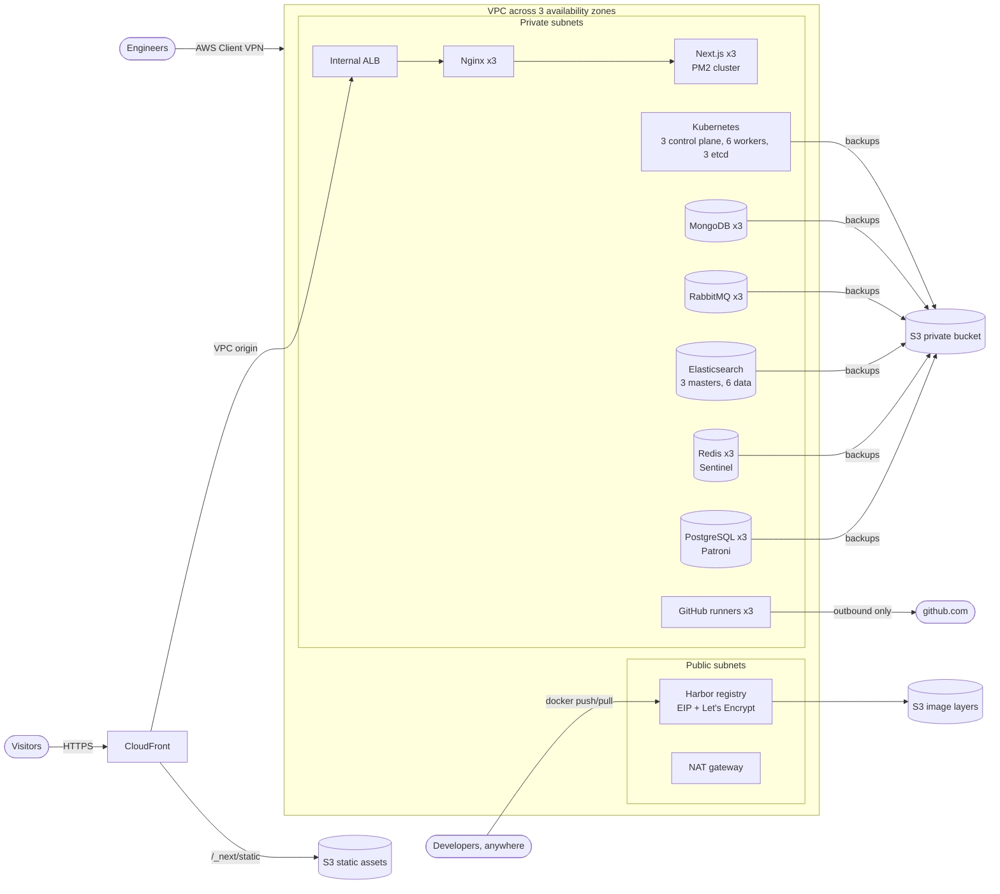
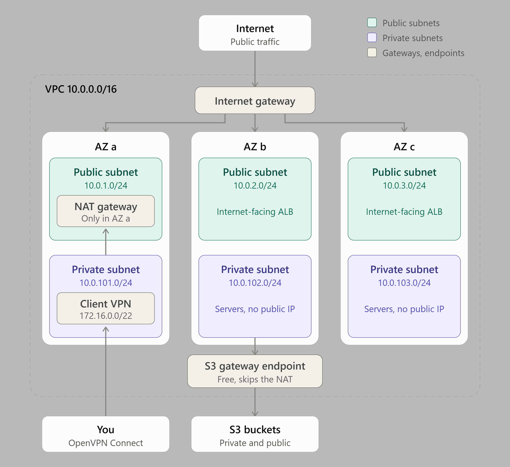
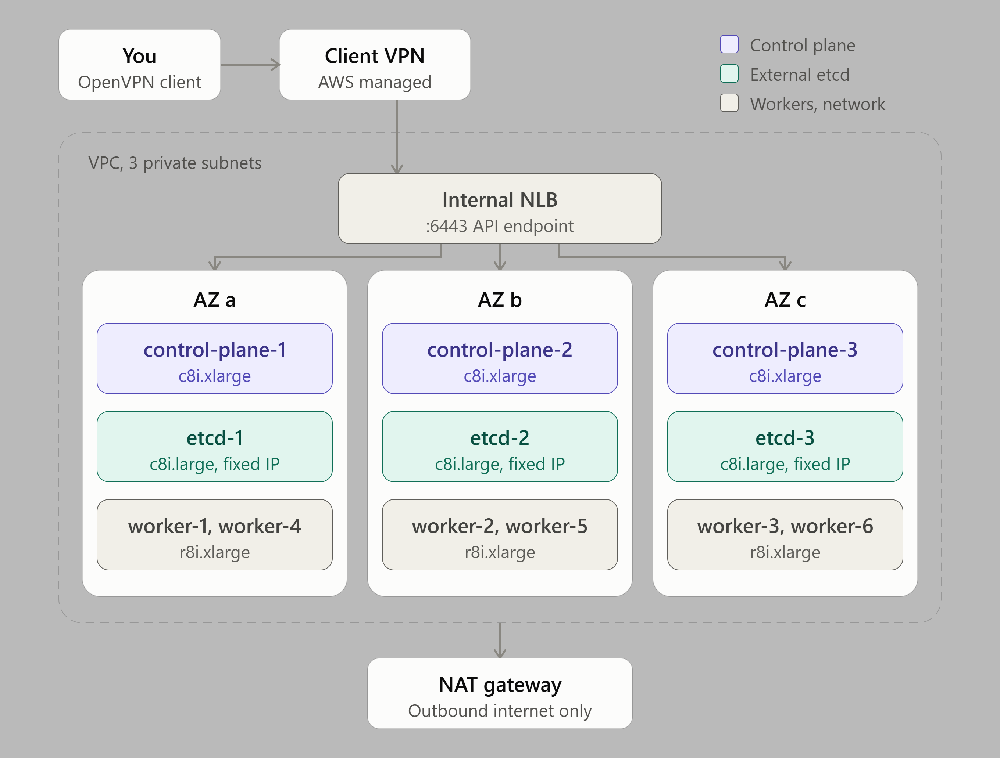
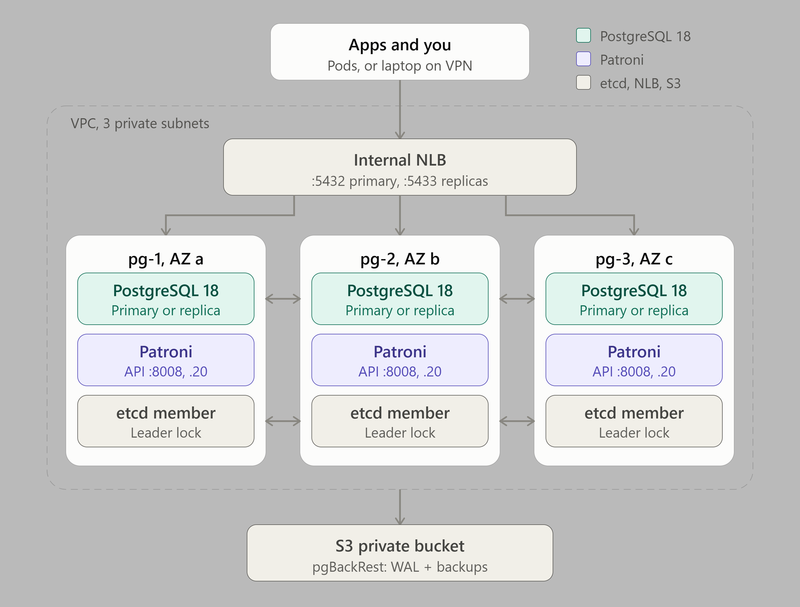
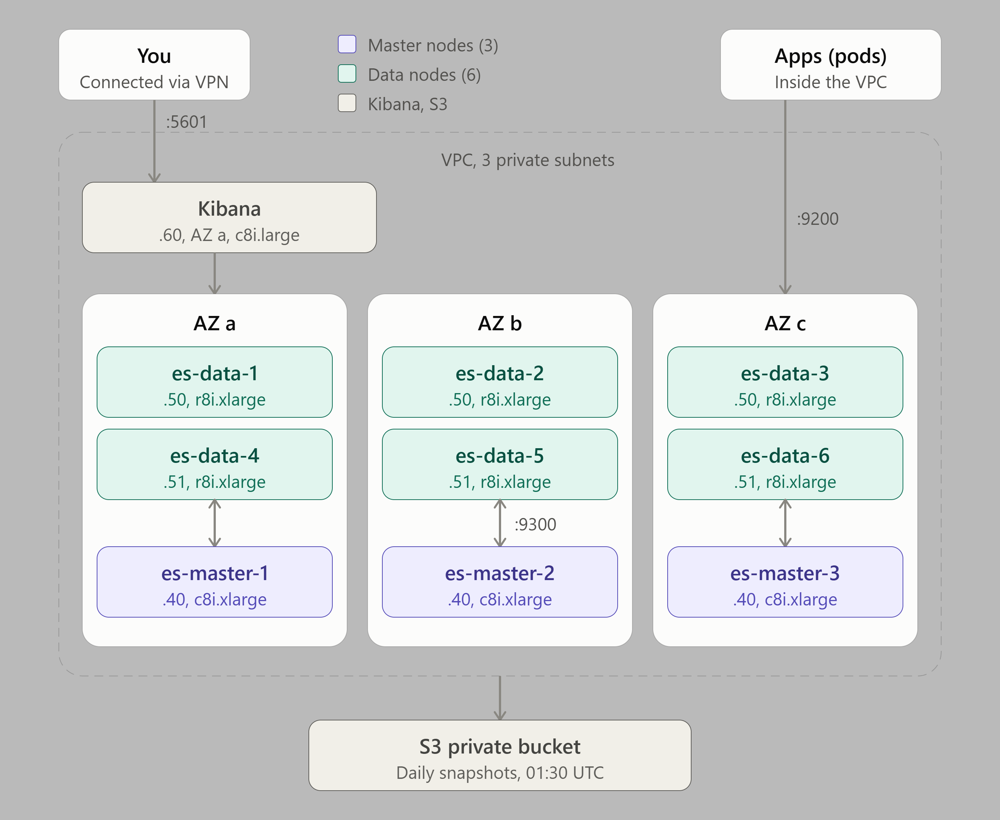

# Self-Managed AWS Production Platform (Terraform)

**A complete, self-managed production platform on AWS, written in Terraform.** Kubernetes,
databases, messaging, search, a frontend, CI runners and a private container registry, all
running on plain EC2 instead of expensive managed services, all highly available across 3
availability zones, and all brought up with a single `terraform apply`.


## Why

Managed services are convenient, but their price grows fast. This project replaces them
with self-managed equivalents on EC2, built to production standards: redundancy, automatic
failover, backups, least-privilege access and no secrets in code.

| Managed service | Replaced by | Module |
|---|---|---|
| Amazon EKS | Kubernetes with kubeadm, external etcd, Cilium | [`kubernetes-cluster`](kubernetes-cluster/) |
| Amazon RDS / Aurora | PostgreSQL 18 with Patroni, etcd and pgBackRest | [`postgres-cluster`](postgres-cluster/) |
| Amazon ElastiCache | Redis 8 with Sentinel | [`redis-sentinel`](redis-sentinel/) |
| Amazon OpenSearch Service | Elasticsearch 9 and Kibana | [`elasticsearch-cluster`](elasticsearch-cluster/) |
| Amazon MQ / SQS | RabbitMQ 4 with quorum queues | [`rabbitmq-cluster`](rabbitmq-cluster/) |
| AWS Amplify / Vercel | Next.js on EC2 with PM2, S3 and CloudFront | [`nextjs-pm2-frontend`](nextjs-pm2-frontend/) |
| Amazon ECR / Docker Hub | Harbor private registry with S3 storage | [`harbor`](harbor/) |
| GitHub-hosted runners (for VPC access) | Self-hosted GitHub Actions runners | [`github-runner`](github-runner/) |
---
Optional
| Managed service | Replaced by | Module |
|---|---|---|
| MongoDB Atlas / DynamoDB | MongoDB 8, replica set | [`mongodb-cluster`](mongodb-cluster/) |
| Amazon Cloudwatch | PMM Grafana Dashboard | [`pmm-grafana-dashboard`](pmm-grafana-dashboard/) |

## Architecture



Every module also has its own architecture diagram in its README.

| | |
|---|---|
|  |  |
|  |  |

## Modules

| Module | What it builds | Highlights |
|---|---|---|
| [`vpc`](vpc/) | VPC, 3 public + 3 private subnets, NAT gateway, S3 gateway endpoint, AWS Client VPN | Certificate-based VPN, split tunnel; private IPs reachable from a laptop |
| [`s3`](s3/) | Private bucket (logs, backups) and public bucket behind CloudFront | Lifecycle rules per prefix, versioning, TLS-only bucket policies, web team IAM group |
| [`kubernetes-cluster`](kubernetes-cluster/) | 3 control plane, 6 workers, 3 external etcd nodes | kubeadm, Cilium, internal NLB for the API, etcd snapshots to S3 every 6 hours |
| [`postgres-cluster`](postgres-cluster/) | 3-node PostgreSQL 18 | Patroni + etcd failover, NLB with read-write and read-only ports, pgBackRest point-in-time recovery |
| [`redis-sentinel`](redis-sentinel/) | 3-node Redis 8 | Sentinel failover, RDB + AOF persistence on separate volumes, daily backups |
| [`elasticsearch-cluster`](elasticsearch-cluster/) | 3 masters, 6 data nodes, Kibana | Zone-aware shard placement, fixed JVM heap per role, nightly snapshots to S3 |
| [`rabbitmq-cluster`](rabbitmq-cluster/) | 3-node RabbitMQ 4 | Quorum queues by default, definitions backed up daily |
| [`mongodb-cluster`](mongodb-cluster/) | 3-member MongoDB 8 replica set | Automatic failover, keyfile auth, nightly consistent `mongodump` from a secondary |
| [`web-server`](web-server/) | 3 Nginx servers behind an internal ALB | Reached only through CloudFront (VPC origin); reverse proxy for Next.js |
| [`nextjs-pm2-frontend`](nextjs-pm2-frontend/) | 3 Next.js servers, S3 + CloudFront | Build once, rolling zero-downtime deploys with Ansible and `pm2 reload` |
| [`github-runner`](github-runner/) | 3 self-hosted GitHub Actions runners | No inbound ports, IAM role instead of AWS keys, Docker and Ansible preinstalled |
| [`harbor`](harbor/) | Harbor registry on EC2 + Elastic IP | Docker API public, web UI VPN-only via split-horizon DNS, image layers in S3, Let's Encrypt |
| [`pmm-grafana-dashboard`](pmm-grafana-dashboard/) | PMM 3 + Grafana, Loki, Prometheus on one server | Agents on every server register themselves; database Query Analytics, logs in S3, Kubernetes dashboards |

## Design principles

The same patterns are applied in every module:

- **One command.** Each server configures itself at first boot from versioned shell scripts
  (installation, clustering, users, backups), so `terraform apply` is the only step.
- **Private by default.** Everything runs in private subnets without public IPs. Engineers reach
  servers, dashboards and SSH through the VPN; nothing is managed over the internet.
- **High availability.** Clusters span 3 availability zones and survive losing a node or a whole
  zone: Raft/quorum-based failover (Patroni + etcd, Sentinel, quorum queues, replica set
  elections) instead of manual recovery.
- **No secrets in code.** Passwords and keys are generated by Terraform, stored in AWS Secrets
  Manager and read by the servers at boot. Servers and CI use IAM roles, never access keys.
- **Least privilege.** One security group per role with explicit rules; each IAM role can touch
  only its own secret and its own backup prefix. Where a service only uploads backups (Redis,
  RabbitMQ, MongoDB), it can't read or delete older ones.
- **Backups everywhere.** Every stateful service backs up to S3 automatically, with retention
  enforced by lifecycle rules, and restore steps are documented in each module.
- **Stable addressing.** Fixed private IPs per service and separate EBS data volumes, so a
  replaced instance comes back with the same address and its data.
- **Reproducible versions.** Software comes from official, signed repositories, pinned to a
  release series and held against accidental upgrades; direct downloads (Harbor, the GitHub
  runner, Node.js) are checksum-verified.
- **Hardened defaults.** IMDSv2 only, encrypted volumes, TLS-only S3 access, and SSM removed in
  favour of SSH over the VPN.

## Tech stack

**Infrastructure:** Terraform, AWS (EC2, VPC, Client VPN, ALB, NLB, CloudFront, S3, Route 53,
Secrets Manager, IAM, EBS, Data Lifecycle Manager)
**Platform:** Kubernetes (kubeadm, Cilium, etcd), Docker, Nginx, PM2, Ansible, GitHub Actions, Harbor
**Observability:** Percona Monitoring and Management (PMM), Grafana, Prometheus, Loki, Grafana Alloy
**Data:** PostgreSQL (Patroni, pgBackRest), Redis (Sentinel), Elasticsearch and Kibana, RabbitMQ, MongoDB
**OS and scripting:** Ubuntu 24.04 LTS, Bash, systemd

## Repository layout

```
.
├── main.tf / variables.tf / outputs.tf / providers.tf   # root module: wires the modules together
├── terraform.tfvars.example                              # copy to terraform.tfvars
├── vpc/  s3/                                             # foundation
├── kubernetes-cluster/                                   # compute platform
├── postgres-cluster/  redis-sentinel/  mongodb-cluster/  # databases
├── elasticsearch-cluster/  rabbitmq-cluster/             # search, messaging
├── web-server/  nextjs-pm2-frontend/                     # web tier
├── github-runner/  harbor/                               # CI/CD and registry
└── pmm-grafana-dashboard/                                # monitoring: metrics and logs
```

Each module has its own README: what it builds, how to use and operate it, and its inputs and outputs.

## Getting started

Requirements: Terraform 1.5 or later, AWS credentials, and an SSH key pair.

```bash
cp terraform.tfvars.example terraform.tfvars   # add your SSH public key, VPN users, GitHub org
terraform init
terraform plan
terraform apply
```

Then download your VPN profile and connect with the OpenVPN client:

```bash
terraform output -json vpn_client_configs | jq -r '.admin' > admin.ovpn
```

`terraform output` lists every endpoint (Kubernetes API, database endpoints, Kibana, RabbitMQ,
Harbor...) and the Secrets Manager ARNs that hold their passwords.

> **Note:** this deploys a large environment (45 EC2 instances, roughly $7,100 a month on-demand;
> see [Estimated cost](#estimated-cost)). Review the plan and
> the instance sizes in each module's `compute.tf` before applying, and destroy what you don't
> need.

## Estimated cost

Rough monthly cost of the whole environment as defined in this repository, in **us-east-1**,
**on-demand**, running 24/7 (730 hours a month). EC2 prices are from AWS's published on-demand
price list (November 2026); the rest are AWS's standard list prices. Check your own setup with the
[AWS Pricing Calculator](https://calculator.aws/) before relying on these numbers.

| Module | Servers | EC2 | EBS (gp3) | Other | ≈ per month |
|---|---|---:|---:|---|---:|
| [`kubernetes-cluster`](kubernetes-cluster/) | 3 × c8i.xlarge, 6 × r8i.xlarge, 3 × c8i.large | $1,833 | 780 GB · $62 | NLB $16 | **$1,911** |
| [`elasticsearch-cluster`](elasticsearch-cluster/) | 3 × c8i.xlarge, 6 × r8i.xlarge, 1 × c8i.large | $1,696 | 900 GB · $72 | | **$1,768** |
| [`postgres-cluster`](postgres-cluster/) | 3 × r8i.xlarge | $608 | 690 GB · $55 | NLB $16 | **$680** |
| [`nextjs-pm2-frontend`](nextjs-pm2-frontend/) | 3 × r8i.xlarge | $608 | 90 GB · $7 | | **$616** |
| [`github-runner`](github-runner/) | 3 × c8i.xlarge | $410 | 300 GB · $24 | | **$434** |
| [`mongodb-cluster`](mongodb-cluster/) | 3 × r8i.large | $304 | 390 GB · $31 | | **$335** |
| [`redis-sentinel`](redis-sentinel/) | 3 × r8i.large | $304 | 240 GB · $19 | | **$323** |
| [`rabbitmq-cluster`](rabbitmq-cluster/) | 3 × r8i.large | $304 | 90 GB · $7 | | **$311** |
| [`web-server`](web-server/) | 3 × c8i.large | $205 | 90 GB · $7 | Internal ALB $16 | **$229** |
| [`pmm-grafana-dashboard`](pmm-grafana-dashboard/) | 1 × r8i.xlarge | $203 | 130 GB · $10 | | **$213** |
| [`harbor`](harbor/) | 1 × m8i.xlarge | $155 | 130 GB · $10 | Elastic IP $4 | **$169** |
| [`vpc`](vpc/) | | | | NAT gateway $33, its IP $4, Client VPN subnet $73 | **$110** |
| Shared | | | | Secrets Manager ~$5, Route 53 private zones $1 | **$6** |
| **Total** | **45 servers** | **$6,631** | **3,830 GB · $306** | **$169** | **≈ $7,100 / month** |

That's **about $85,000 a year** before usage-based charges.

**Unit prices used:** c8i.large $68/month ($0.0937/h), c8i.xlarge $137 ($0.1874/h), r8i.large
$101 ($0.1389/h), r8i.xlarge $203 ($0.2778/h), m8i.xlarge $155 ($0.2117/h); gp3 $0.08 per GB-month;
load balancer $0.0225/h; NAT gateway $0.045/h; public IPv4 $0.005/h; Client VPN $0.10/h per
associated subnet.

### Not included (depends on usage)

| Item | Price | Notes |
|---|---|---|
| Client VPN connections | $0.05 per connected user per hour | e.g. 10 people, 8 h × 22 days ≈ $88 |
| Data between availability zones | $0.01/GB each way | Database replication and cluster traffic cross AZs by design |
| Internet traffic out | $0.09/GB (first 10 TB) | Harbor pulls from outside AWS, API responses |
| CloudFront | from $0.085/GB | Frontend and public assets |
| NAT gateway data | $0.045/GB | Package downloads, external APIs (S3 skips it via the free endpoint) |
| S3 | $0.023/GB-month + requests | Backups, Loki logs, Harbor images, frontend releases |
| EBS snapshots | $0.05/GB-month | Harbor and monitoring daily snapshots (incremental) |
| Load balancer capacity units | per LCU-hour | Small at low traffic |

### Ways to lower it

- **Savings Plans or Reserved Instances:** committing to 1 or 3 years of compute is the biggest
  single saving for servers that run 24/7.
- **The two largest modules** are Kubernetes and Elasticsearch (about half the bill together,
  mostly their 6 × r8i.xlarge each). Size them to real load once it's measured.
- **Non-production environments** (`dev`, `staging`) rarely need 3 of everything or 24/7 uptime:
  smaller instance types, fewer nodes, or stopping them outside working hours.
- **Graviton (ARM) instances** (e.g. r8g) cost less per hour, but the first-boot scripts download
  `amd64` packages and binaries, so they'd need adapting first.

### Compared with AWS managed services

The same capacity on the managed service each module replaces, priced from AWS's official
us-east-1 on-demand price lists (November 2026). Each managed option is the closest match in size
and redundancy (3 nodes across 3 AZs); where a service doesn't offer Intel instances, its Graviton
equivalent is used.

| Service | Self-managed (this repo) | Managed equivalent | Managed | Difference |
|---|---:|---|---:|---:|
| PostgreSQL | $680 | RDS Multi-AZ DB cluster (writer + 2 readable standbys), db.r8gd.xlarge, 200 GB gp3 | $1,265 | **−$585** (−46%) |
| Elasticsearch | $1,768 | OpenSearch Service: 3 × c7i.xlarge masters + 6 × r7i.xlarge data, 600 GB gp3 | $2,552 | **−$784** (−31%) |
| RabbitMQ | $311 | Amazon MQ RabbitMQ 3-node cluster, mq.m7g.large | $599 | **−$287** (−48%) |
| MongoDB | $335 | Amazon DocumentDB, 3 × db.r8g.large, 100 GB | $615 | **−$279** (−45%) |
| Redis | $323 | ElastiCache, 3 × cache.r7g.large (Redis OSS) | $480 | **−$156** (−33%) |
| Kubernetes | $1,911 | EKS control plane + the same 6 × r8i.xlarge workers | $1,338 | **+$574** (+43%) |
| **Total** | **$5,330** | | **$6,848** | **−$1,518 / month** |

**Self-managing these six services costs about $1,500 a month less (~$18,000 a year, 22%)** than
their managed equivalents, at list prices.

What the numbers say, honestly:

- **The databases and brokers are where self-managing pays off:** roughly 30-50% cheaper each.
- **Kubernetes is the exception.** EKS charges $73 a month for a managed control plane, while this
  repository runs 3 control plane and 3 etcd servers (~$600). Self-managed Kubernetes here is a
  choice for control and learning, not for cost.
- **Harbor vs Amazon ECR:** ECR charges $0.10 per GB-month of images. At 500 GB that's ~$50 against
  Harbor's ~$180 (server + S3), so **ECR is cheaper until roughly 2 TB of images**. Harbor's reasons
  are data control and features (projects, scanning, replication), not price.

What the comparison leaves out:

- **People's time.** Managed services include patching, upgrades, backups, failover and AWS support.
  Self-managed, that work is yours; even a few hours a month of an engineer's time can outweigh
  the savings above.
- **Sizes aren't identical.** Amazon MQ's mq.m7g.large has 8 GiB of RAM (our nodes have 16 GiB);
  ElastiCache with Valkey instead of Redis OSS is about 20% cheaper ($384); DocumentDB is
  MongoDB-*compatible*, not MongoDB, and also bills I/O ($0.20 per million requests).
- **Traffic between zones.** Managed services don't bill their internal replication traffic;
  self-managed clusters pay $0.01/GB each way between AZs.
- **Not compared:** the Next.js frontend (Amplify/Vercel), the CI runners (GitHub-hosted minutes)
  and monitoring (CloudWatch) are priced by usage, so they depend on traffic, build minutes and
  data volume rather than on server sizes.

## Trade-offs

Self-managing saves money but moves work to you: patching, upgrades and monitoring are your
responsibility. Some deliberate simplifications are documented in the module READMEs, for example:

- **One NAT gateway** for the private subnets, to save cost; one per AZ removes that single point
  of failure.
- **No TLS inside the VPC** for the databases and message brokers: traffic stays in the private
  network and VPN traffic is encrypted, but login credentials cross the VPC in clear text.
- **Single-instance Harbor**: if it's down, pushes and new pulls stop until it's back.

Each module's README ends with a TO-DO list of the next improvements.
