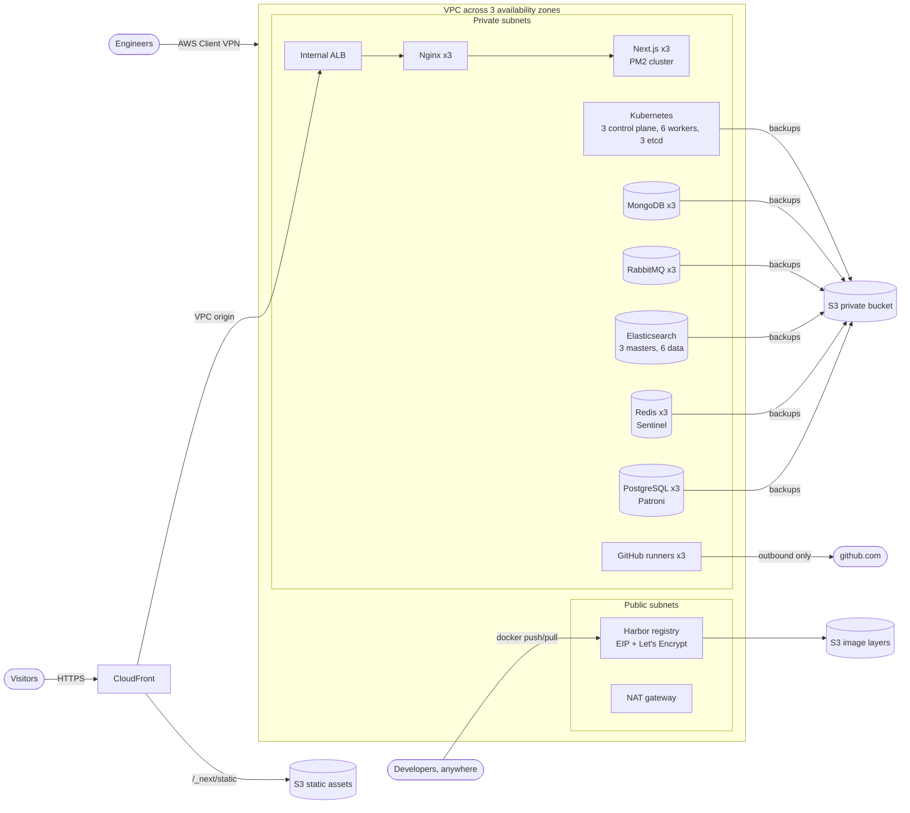
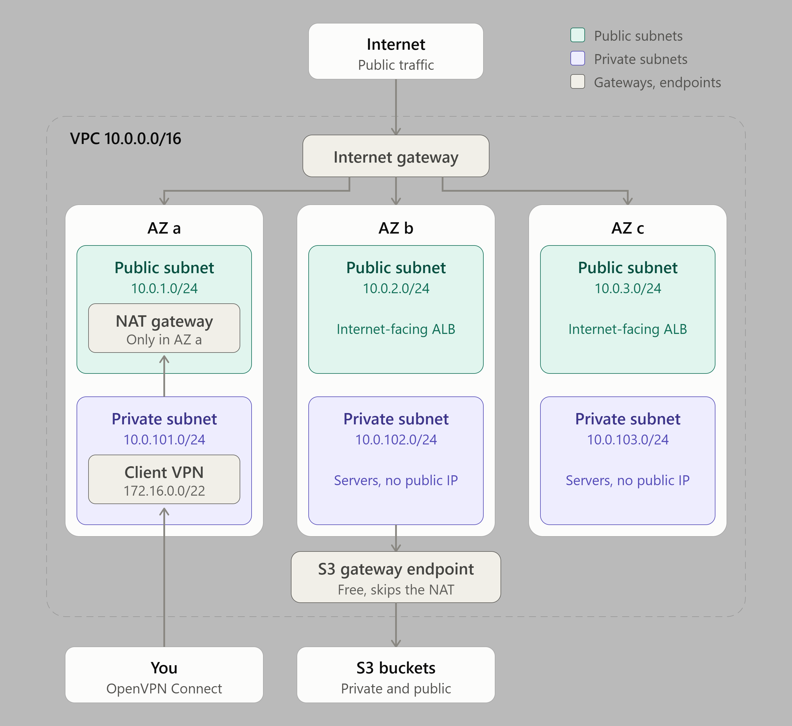
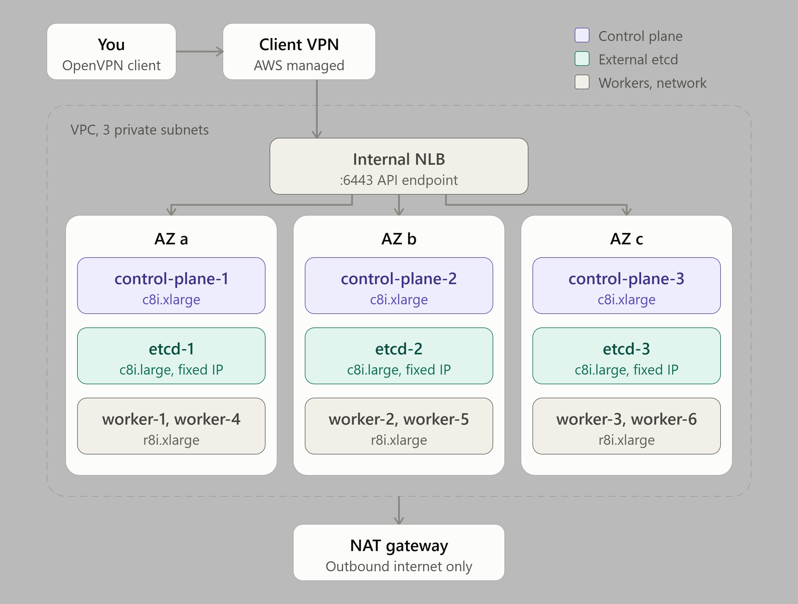
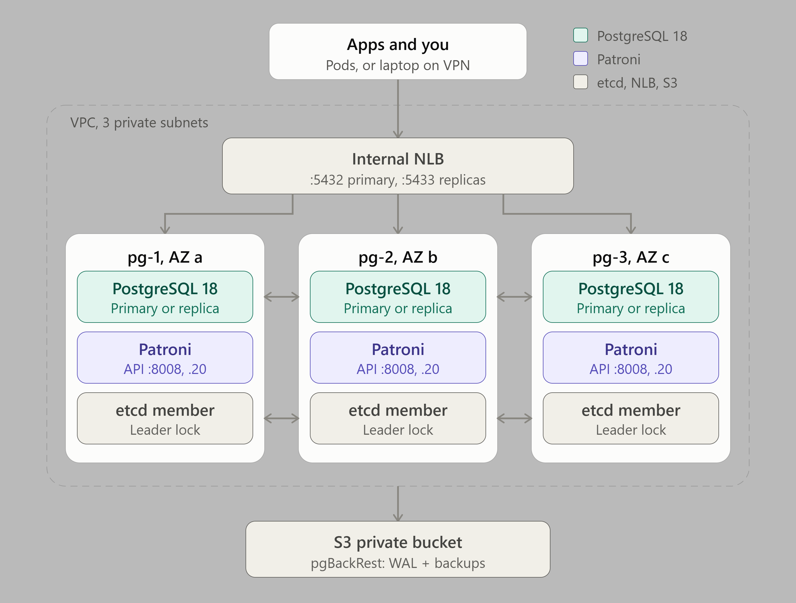
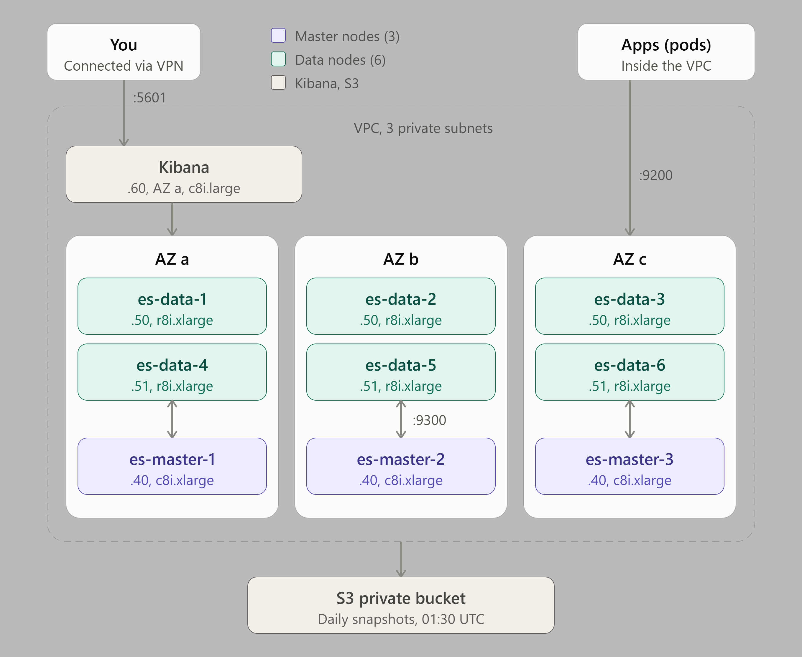

# AWS Production IT Infrastructure

**A complete, self-managed production platform on AWS, written in Terraform.** Kubernetes,
databases, messaging, search, a frontend, CI runners and a private container registry, all
running on plain EC2 instead of expensive managed services, all highly available across 3
availability zones, and all brought up with a single `terraform apply`.


## Why

Managed services are convenient, but their price grows fast. This project replaces them
with self-managed equivalents on EC2, built to production standards: redundancy, automatic
failover, backups, least-privilege access and no secrets in code.

| Managed service | Replaced by | Module |
|---|---|---|
| Amazon EKS | Kubernetes with kubeadm, external etcd, Cilium | [`kubernetes-cluster`](kubernetes-cluster/) |
| Amazon RDS / Aurora | PostgreSQL 18 with Patroni, etcd and pgBackRest | [`postgres-cluster`](postgres-cluster/) |
| Amazon ElastiCache | Redis 8 with Sentinel | [`redis-sentinel`](redis-sentinel/) |
| Amazon OpenSearch Service | Elasticsearch 9 and Kibana | [`elasticsearch-cluster`](elasticsearch-cluster/) |
| Amazon MQ / SQS | RabbitMQ 4 with quorum queues | [`rabbitmq-cluster`](rabbitmq-cluster/) |
| MongoDB Atlas / DynamoDB | MongoDB 8 replica set | [`mongodb-cluster`](mongodb-cluster/) |
| AWS Amplify / Vercel | Next.js on EC2 with PM2, S3 and CloudFront | [`nextjs-pm2-frontend`](nextjs-pm2-frontend/) |
| Amazon ECR / Docker Hub | Harbor private registry with S3 storage | [`harbor`](harbor/) |
| GitHub-hosted runners (for VPC access) | Self-hosted GitHub Actions runners | [`github-runner`](github-runner/) |

## Architecture



Every module also has its own architecture diagram in its README.

| | |
|---|---|
|  |  |
|  |  |

## Modules

| Module | What it builds | Highlights |
|---|---|---|
| [`vpc`](vpc/) | VPC, 3 public + 3 private subnets, NAT gateway, S3 gateway endpoint, AWS Client VPN | Certificate-based VPN, split tunnel; private IPs reachable from a laptop |
| [`s3`](s3/) | Private bucket (logs, backups) and public bucket behind CloudFront | Lifecycle rules per prefix, versioning, TLS-only bucket policies, web team IAM group |
| [`kubernetes-cluster`](kubernetes-cluster/) | 3 control plane, 6 workers, 3 external etcd nodes | kubeadm, Cilium, internal NLB for the API, etcd snapshots to S3 every 6 hours |
| [`postgres-cluster`](postgres-cluster/) | 3-node PostgreSQL 18 | Patroni + etcd failover, NLB with read-write and read-only ports, pgBackRest point-in-time recovery |
| [`redis-sentinel`](redis-sentinel/) | 3-node Redis 8 | Sentinel failover, RDB + AOF persistence on separate volumes, daily backups |
| [`elasticsearch-cluster`](elasticsearch-cluster/) | 3 masters, 6 data nodes, Kibana | Zone-aware shard placement, fixed JVM heap per role, nightly snapshots to S3 |
| [`rabbitmq-cluster`](rabbitmq-cluster/) | 3-node RabbitMQ 4 | Quorum queues by default, definitions backed up daily |
| [`mongodb-cluster`](mongodb-cluster/) | 3-member MongoDB 8 replica set | Automatic failover, keyfile auth, nightly consistent `mongodump` from a secondary |
| [`web-server`](web-server/) | 3 Nginx servers behind an internal ALB | Reached only through CloudFront (VPC origin); reverse proxy for Next.js |
| [`nextjs-pm2-frontend`](nextjs-pm2-frontend/) | 3 Next.js servers, S3 + CloudFront | Build once, rolling zero-downtime deploys with Ansible and `pm2 reload` |
| [`github-runner`](github-runner/) | 3 self-hosted GitHub Actions runners | No inbound ports, IAM role instead of AWS keys, Docker and Ansible preinstalled |
| [`harbor`](harbor/) | Harbor registry on EC2 + Elastic IP | Docker API public, web UI VPN-only via split-horizon DNS, image layers in S3, Let's Encrypt |

## Design principles

The same patterns are applied in every module:

- **One command.** Each server configures itself at first boot from versioned shell scripts
  (installation, clustering, users, backups), so `terraform apply` is the only step.
- **Private by default.** Everything runs in private subnets without public IPs. Engineers reach
  servers, dashboards and SSH through the VPN; nothing is managed over the internet.
- **High availability.** Clusters span 3 availability zones and survive losing a node or a whole
  zone: Raft/quorum-based failover (Patroni + etcd, Sentinel, quorum queues, replica set
  elections) instead of manual recovery.
- **No secrets in code.** Passwords and keys are generated by Terraform, stored in AWS Secrets
  Manager and read by the servers at boot. Servers and CI use IAM roles, never access keys.
- **Least privilege.** One security group per role with explicit rules; each IAM role can touch
  only its own secret and its own backup prefix. Where a service only uploads backups (Redis,
  RabbitMQ, MongoDB), it can't read or delete older ones.
- **Backups everywhere.** Every stateful service backs up to S3 automatically, with retention
  enforced by lifecycle rules, and restore steps are documented in each module.
- **Stable addressing.** Fixed private IPs per service and separate EBS data volumes, so a
  replaced instance comes back with the same address and its data.
- **Reproducible versions.** Software comes from official, signed repositories, pinned to a
  release series and held against accidental upgrades; direct downloads (Harbor, the GitHub
  runner, Node.js) are checksum-verified.
- **Hardened defaults.** IMDSv2 only, encrypted volumes, TLS-only S3 access, and SSM removed in
  favour of SSH over the VPN.

## Tech stack

**Infrastructure:** Terraform, AWS (EC2, VPC, Client VPN, ALB, NLB, CloudFront, S3, Route 53,
Secrets Manager, IAM, EBS, Data Lifecycle Manager)
**Platform:** Kubernetes (kubeadm, Cilium, etcd), Docker, Nginx, PM2, Ansible, GitHub Actions, Harbor
**Data:** PostgreSQL (Patroni, pgBackRest), Redis (Sentinel), Elasticsearch and Kibana, RabbitMQ, MongoDB
**OS and scripting:** Ubuntu 24.04 LTS, Bash, systemd

## Repository layout

```
.
├── main.tf / variables.tf / outputs.tf / providers.tf   # root module: wires the modules together
├── terraform.tfvars.example                              # copy to terraform.tfvars
├── vpc/  s3/                                             # foundation
├── kubernetes-cluster/                                   # compute platform
├── postgres-cluster/  redis-sentinel/  mongodb-cluster/  # databases
├── elasticsearch-cluster/  rabbitmq-cluster/             # search, messaging
├── web-server/  nextjs-pm2-frontend/                     # web tier
└── github-runner/  harbor/                               # CI/CD and registry
```

Each module has its own README: what it builds, how to use and operate it, and its inputs and outputs.

## Getting started

Requirements: Terraform 1.5 or later, AWS credentials, and an SSH key pair.

```bash
cp terraform.tfvars.example terraform.tfvars   # add your SSH public key, VPN users, GitHub org
terraform init
terraform plan
terraform apply
```

Then download your VPN profile and connect with the OpenVPN client:

```bash
terraform output -json vpn_client_configs | jq -r '.admin' > admin.ovpn
```

`terraform output` lists every endpoint (Kubernetes API, database endpoints, Kibana, RabbitMQ,
Harbor...) and the Secrets Manager ARNs that hold their passwords.

> **Note:** this deploys a large environment (more than 40 EC2 instances). Review the plan and
> the instance sizes in each module's `compute.tf` before applying, and destroy what you don't
> need.

## Trade-offs

Self-managing saves money but moves work to you: patching, upgrades and monitoring are your
responsibility. Some deliberate simplifications are documented in the module READMEs, for example:

- **One NAT gateway** for the private subnets, to save cost; one per AZ removes that single point
  of failure.
- **No TLS inside the VPC** for the databases and message brokers: traffic stays in the private
  network and VPN traffic is encrypted, but login credentials cross the VPC in clear text.
- **Single-instance Harbor**: if it's down, pushes and new pulls stop until it's back.

Each module's README ends with a TO-DO list of the next improvements.
