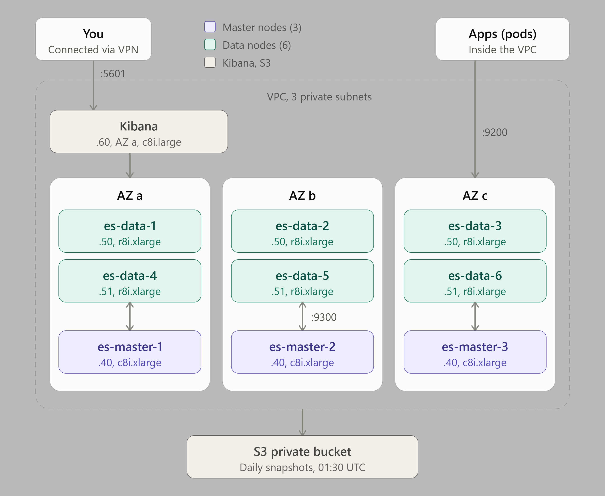

# Elasticsearch Cluster on EC2

A self-managed, highly available Elastic Cluster, 3 master nodes, 6 data nodes and 1 Kibana node for internal developer use, because
Amazon OpenSearch Service is expensive. Everything runs in the private subnets and
bootstraps itself at first boot, so `terraform apply` is the only step.



| Node | Count | Type | JVM heap | Storage | Role |
|---|---|---|---|---|---|
| Master | 3 | `c8i.xlarge` (4 vCPU, 8 GiB) | 3 GiB | 30 GiB root | Holds the cluster state, elects a leader. Stores no data |
| Data | 6 | `r8i.xlarge` (4 vCPU, 32 GiB) | 14 GiB | 30 GiB root + 100 GiB gp3 data | Stores indices, runs searches and ingest pipelines |
| Kibana | 1 | `c8i.large` (2 vCPU, 4 GiB) | — (Node.js) | 30 GiB root | Web UI, only reachable over the VPN |

Version **9.5.6** (Elasticsearch and Kibana must match), from Elastic's apt repository.

## How it's made production-ready

- **Dedicated masters.** Elections and cluster state never compete with heavy queries,
  and 3 masters keep a majority (2) if one fails or an AZ goes down.
- **Zone awareness.** Each node knows its AZ (`node.attr.zone`), and Elasticsearch never
  puts a shard's primary and replica in the same AZ. With the default 1 replica, losing
  a whole AZ loses no data.
- **Login required, no certificates for clients.** The REST API (port 9200) is **plain
  HTTP**, but every request needs a username/password or API key. Apps and Kibana don't
  need any certificate. Passwords live in Secrets Manager, never in user data.
- **No certificates to manage anywhere.** Between the nodes (port 9300), Elasticsearch
  insists that TLS is *switched on* while login is enabled, but with
  `verification_mode: none` nothing is ever checked. Each node simply makes its own
  throwaway self-signed certificate at first boot. There's no CA, no certificate in
  Terraform, nothing to renew. **The security group decides who may join:** port 9300 is
  open only to the Elasticsearch nodes themselves.
- **Snapshots.** Every night at 01:30 UTC, a snapshot policy saves all indices and the
  cluster state to the private bucket (`backups/elasticsearch/`, repository `s3-backups`)
  and deletes snapshots older than 30 days (keeping at least 5).
- **Fixed JVM heap per role**: `-Xms` = `-Xmx` = `master_heap_size` (3g) on masters and
  `data_heap_size` (14g) on data nodes, written to `/etc/elasticsearch/jvm.options.d/heap.options`.
  Equal min and max means the heap never resizes at runtime. The rest of the RAM is left
  to the OS filesystem cache, which Elasticsearch relies on for fast searches (data
  nodes: 14 GiB heap, ~18 GiB cache).

## Using it

**Kibana:** connect the VPN and open `terraform output -raw kibana_url`
(`http://10.0.101.60:5601`). Log in as `elastic` with the password from the secret:

```bash
aws secretsmanager get-secret-value --secret-id "$(terraform output -raw elasticsearch_secret_arn)" \
  --query SecretString --output text | jq -r .elastic_password
```

Then create personal users or roles for developers under **Stack Management → Users**;
keep `elastic` for administration.

**Applications** (e.g. Kubernetes pods) connect to the data nodes over plain HTTP with
their own user or API key; no certificate needed:

```bash
# Create an API key for an app (prompts for the elastic password)
curl -u elastic http://10.0.101.50:9200/_security/api_key \
  -H 'Content-Type: application/json' -d '{"name": "my-app"}'
```

Give the client all 6 data node URLs (`terraform output elasticsearch_hosts`); the official
clients spread requests over them and skip a node that's down.

## Operating the cluster

From any machine on the VPN:

```bash
ES="curl -s -u elastic:<password> http://10.0.101.40:9200"
$ES/_cat/health?v              # green / yellow / red
$ES/_cat/nodes?v               # roles, heap, CPU, which node is the elected master (*)
$ES/_cat/shards?v              # where each shard lives
$ES/_cat/allocation?v          # disk use per data node
$ES/_slm/policy/daily-snapshots?pretty   # last snapshot, next run
$ES/_snapshot/s3-backups/_all?pretty     # list snapshots
```

On a node: `sudo tail -f /var/log/es-bootstrap.log` (first boot),
`/var/log/elasticsearch/` and `/var/log/kibana/kibana.log`.

## Things to know

- **Disk watermarks.** At 85% disk use a data node gets no new shards; at 95% its indices
  become read-only. Watch `_cat/allocation` and grow `data_volume_size` in time
  (EBS can grow without downtime; then `sudo xfs_growfs /var/lib/elasticsearch`).
- **Restore a snapshot:** `POST _snapshot/s3-backups/<snapshot>/_restore` (close or delete the
  target indices first). Practise it once.
- **Upgrades:** rolling, one node at a time, data nodes first, then masters, then Kibana.
  Bump `elastic_version` so new nodes match.
- **Never add an S3 lifecycle rule on `backups/elasticsearch/`.** Snapshots are incremental
  and share files; the snapshot policy deletes old ones safely.
- **Passwords and data cross the VPC unencrypted.** HTTP on 9200 sends credentials (Basic
  auth) and documents in clear text. That's acceptable only because port 9200 is reachable
  from inside the VPC alone, and VPN users' traffic is encrypted by the VPN. Never expose
  9200 through a public load balancer. If compliance ever requires encryption in transit,
  set `xpack.security.http.ssl.enabled: true` with a certificate (see the TO-DO list).
- **Keep port 9300 locked to the Elasticsearch security group.** With `verification_mode: none`,
  any machine that can reach 9300 could present any certificate and join the cluster as a
  node, and then read every index. The `es_transport_self` rule is what prevents that; never
  open 9300 to the VPC or anywhere else.
- **Don't set `xpack.security.transport.ssl.enabled: false`.** Elasticsearch won't start a
  multi-node cluster with login enabled and transport TLS off. The only way would be
  `xpack.security.enabled: false`, which removes all logins: anyone in the VPC could read
  or delete every index.
- **Licence.** Elasticsearch and Kibana run on the free Basic licence, which includes security,
  snapshots and Kibana. Fine for internal use.

## Files

| File | What's in it |
|---|---|
| `compute.tf` | AMI, key pair, masters, data nodes + their gp3 volumes, Kibana |
| `secret-manager.tf` | Passwords and Kibana encryption keys |
| `security-groups.tf` | 9200 from the VPC, 9300 between nodes, Kibana and SSH from the VPN |
| `iam.tf` | Read the secret; snapshot access to `backups/elasticsearch/` |
| `scripts/` | First-boot scripts: `elasticsearch.sh` (masters and data nodes), `kibana.sh` (Kibana + cluster setup: passwords, snapshot repository, snapshot policy) |

## Inputs

| Name | Default | Description |
|---|---|---|
| `project_name`, `environment` | (required) | Used in resource names |
| `vpc_id`, `vpc_cidr` | (required) | The VPC; its CIDR may use the REST API |
| `private_subnet_ids`, `private_subnet_cidrs` | (required) | Exactly 3 |
| `ssh_public_key`, `vpn_security_group_id` | (required) | SSH key; the VPN may SSH in and open Kibana |
| `backup_bucket_name`, `backup_bucket_arn` | (required) | The private bucket from the `s3` module |
| `backup_prefix` | `"backups/elasticsearch"` | Snapshot repository location |
| `elastic_version` | `"9.5.6"` | Exact version, same for all nodes and Kibana |
| `master_instance_type` / `master_heap_size` | `"c8i.xlarge"` / `"3g"` | 3 masters |
| `data_instance_type` / `data_heap_size` / `data_node_count` | `"r8i.xlarge"` / `"14g"` / `6` | Data nodes (multiple of 3). Heap ≤ half the RAM and < 30g |
| `data_volume_size` | `100` | GiB gp3 per data node |
| `kibana_instance_type` | `"c8i.large"` | Kibana |

## Outputs

`kibana_url`, `elasticsearch_hosts`, `master_private_ips`, `data_private_ips`, `secret_arn`, `snapshot_location`.

## TO-DO

- [ ] Personal Kibana users/roles for developers (or SSO), instead of sharing `elastic`
- [ ] HTTPS on the REST API, if encryption in transit becomes a requirement
- [ ] Index lifecycle (ILM) policies for logs-style indices (rollover, delete after N days)
