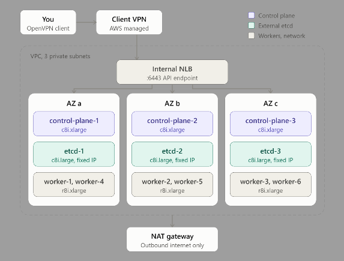

# Kubernetes cluster on EC2 (kubeadm + external etcd)

A self-managed, highly available Kubernetes cluster on plain EC2, as an alternative
to Amazon EKS to reduce cost. The nodes bootstrap themselves with `kubeadm` at first
boot, so `terraform apply` is the only step.

## Architecture

| Role | Count | Instance type | Root disk | Security group |
|---|---|---|---|---|
| Control plane | 3 | `c8i.xlarge` | 30 GB gp3 | `control-plane` |
| Worker | 6 | `r8i.xlarge` | 100 GB gp3 | `worker` |
| External etcd | 3 | `c8i.large` | 30 GB gp3 | `etcd` |



- **All nodes are in private subnets** with no public IPs. You reach them by connecting
  the AWS Client VPN (see [vpc/README.md](../vpc/README.md)) and SSHing to their private
  IPs as `ubuntu`. Port 22 accepts connections only from the VPN.
- **Nodes are spread round-robin across the 3 AZs**, so one AZ outage leaves 2 of 3
  control-plane and etcd members running (etcd keeps quorum).
- **etcd runs separately from the control plane** ("external etcd"), so a busy
  API server can't starve etcd, and the two can be scaled and backed up independently.
- **The API server sits behind an internal NLB**, which is kubeadm's `controlPlaneEndpoint`.
  Every node and kubectl uses it, so any control-plane node can fail.

| Component | Version |
|---|---|
| OS | Ubuntu 24.04 LTS |
| Kubernetes | 1.37 (`kubernetes_version`) |
| Container runtime | containerd (Ubuntu package) |
| CNI | Cilium 1.20.4 (`cilium_version`) |

## Files

| File | What's in it |
|---|---|
| `compute.tf` | Ubuntu AMI lookup, the 12 EC2 instances and their user data |
| `security-groups.tf` | Security groups and rules for control plane, workers and etcd |
| `nlb.tf` | Internal NLB, target group and listener for the API server |
| `iam.tf` | One IAM role + instance profile per node type (control-plane, worker, etcd) |
| `bootstrap-bucket.tf` | Private S3 bucket the nodes use to share certs and join commands, plus per-role IAM access to it |
| `backups.tf` | Lets the etcd nodes upload snapshots to `backups/kubernetes/etcd/` in the private bucket |
| `variables.tf` / `outputs.tf` | Module inputs and outputs |
| `scripts/` | Bootstrap scripts that run on the nodes. See [scripts/README.md](scripts/README.md) |

## Usage

Called from the root `main.tf`:

```hcl
module "kubernetes_cluster" {
  source = "./kubernetes-cluster"

  project_name = var.project_name
  environment  = var.environment

  vpc_id               = module.vpc.vpc_id
  vpc_cidr             = module.vpc.vpc_cidr
  private_subnet_ids   = module.vpc.private_subnet_ids
  private_subnet_cidrs = module.vpc.private_subnet_cidrs

  backup_bucket_name = module.s3.private_bucket_name
  backup_bucket_arn  = module.s3.private_bucket_arn

  ssh_public_key               = var.ssh_public_key
  ssh_source_security_group_id = module.vpc.vpn_security_group_id
}
```

### Inputs

| Name | Default | Description |
|---|---|---|
| `project_name` | (required) | Used in resource names and as the Kubernetes cluster name |
| `environment` | (required) | Used in resource names |
| `vpc_id` | (required) | VPC for the security groups and NLB target group |
| `vpc_cidr` | (required) | Allowed to reach the API server, NodePorts and ICMP |
| `private_subnet_ids` | (required) | Subnets the nodes and the NLB are placed in |
| `private_subnet_cidrs` | (required) | Same order as `private_subnet_ids`; used for the fixed etcd IPs |
| `ssh_public_key` | (required) | Public key installed for user `ubuntu` on every node |
| `ssh_source_security_group_id` | (required) | Group allowed to SSH in: the VPN endpoint's |
| `backup_bucket_name`, `backup_bucket_arn` | (required) | The private bucket from the `s3` module |
| `backup_prefix` | `"backups/kubernetes"` | etcd snapshots go to `<prefix>/etcd/` |
| `etcd_backup_schedule` | `"*-*-* 00/6:00:00"` | systemd `OnCalendar`: every 6 hours, UTC |
| `kubernetes_version` | `"1.37"` | Kubernetes minor version |
| `cilium_version` | `"1.20.4"` | Cilium version |
| `cilium_cli_version` | `"0.20.2"` | cilium-cli version used to install Cilium |
| `pod_cidr` | `"10.244.0.0/16"` | Pod IPs. Must not overlap the VPC or `service_cidr` |
| `service_cidr` | `"10.96.0.0/12"` | ClusterIP services. Must not overlap the VPC or `pod_cidr` |

### Outputs

| Name | Description |
|---|---|
| `api_endpoint` | Internal NLB DNS name for the API server (port 6443) |
| `bootstrap_bucket` | Name of the bootstrap S3 bucket |
| `control_plane_instance_ids` | Control-plane instance IDs |
| `control_plane_private_ips` / `worker_private_ips` / `etcd_private_ips` | Private IPs per role |

## Deploying

From the root folder:

```bash
terraform plan
terraform apply
```

After about 10–15 minutes all nodes should be `Ready`. To check, connect the VPN and
SSH to control-plane-1 (its IP is the first entry of `terraform output control_plane_private_ips`):

```bash
ssh ubuntu@<control-plane-1-ip>
sudo kubectl get nodes -o wide
```

Then **delete the bootstrap secrets** (etcd keys, join tokens) from S3:

```bash
aws s3 rm "s3://$(terraform output -raw kubernetes_bootstrap_bucket)" --recursive
```

Watching the logs, using kubectl from your laptop and fixing a failed bootstrap are
all covered in [scripts/README.md](scripts/README.md).

## Things to know

- **Changing `user_data` or the AMI never replaces a running node.** Both are in
  `ignore_changes`, so script and AMI updates only reach newly created nodes.
- **Changing an etcd node's subnet or IP replaces it.** etcd members have fixed IPs;
  replacing one means removing and re-adding the member with `etcdctl`.
- **Self-managed means you own the control plane.** With EKS, AWS runs, patches and
  backs up the control plane and etcd. Here that's your job (see the TO-DO list).

## TO-DO

- [x] etcd backups: every 6 hours to `backups/kubernetes/etcd/` in the private bucket (see [scripts/README.md](scripts/README.md#etcd-backups))
- [ ] Certificate backups (`/etc/kubernetes/pki`), needed together with etcd for a full restore
- [ ] AWS cloud controller manager, for `type: LoadBalancer` Services
- [ ] AWS EBS CSI driver, for PersistentVolumes
- [ ] Monitoring and logging (e.g. kube-prometheus-stack + a log shipper)
- [ ] Upgrade runbook (`kubeadm upgrade`, one minor version at a time)
- [ ] Node replacement runbook (new join tokens, etcd member replacement)
