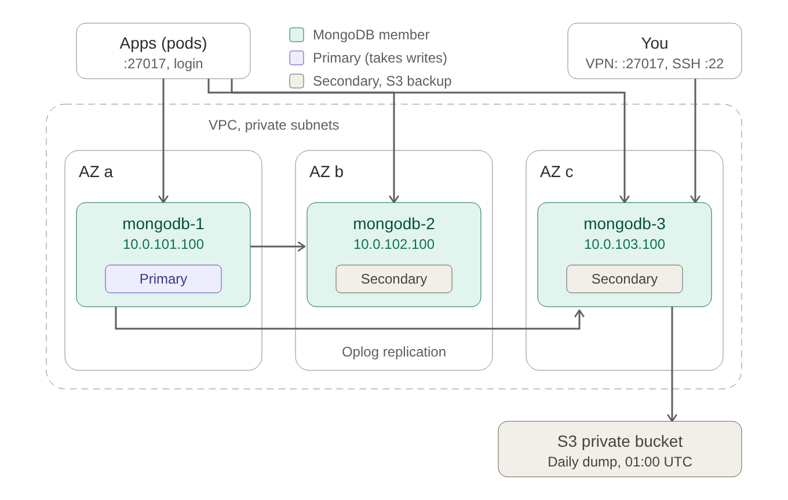

# MongoDB Cluster on EC2
Because using AWS MongoDB Atlas/DynamoDB is expensive and 
maybe your company still use NoSQL, this could be your alternative

## What it builds

A 3-member **replica set**: one primary takes the writes, two secondaries keep a full copy
each. One member per AZ, in the private subnets. They install and form the replica set at
first boot, so `terraform apply` is the only step.

```
                 ┌──────────────────── VPC (private subnets a, b, c) ────────────────────┐
  apps (pods) ──►│  :27017 (login required)                                              │
                 │   mongodb-1 .100 (a)     mongodb-2 .100 (b)     mongodb-3 .100 (c)     │
                 │      PRIMARY ──── replication (oplog) ────► SECONDARY, SECONDARY       │
  you (VPN) ────►│  :27017, :22                                                          │
                 └──────── daily mongodump from a secondary ─► S3 backups/mongodb/ ──────┘
```


| | |
|---|---|
| Members | 3 × `r8i.large` (2 vCPU, 16 GiB; WiredTiger cache ~7.5 GiB), Ubuntu 24.04, fixed IPs `.100` |
| Storage | 30 GiB root + 100 GiB gp3 XFS data volume (`/var/lib/mongodb`) per member, encrypted |
| Version | MongoDB **8.0** from repo.mongodb.org (newest patch, pinned and held) |
| Security | Login required (SCRAM); members authenticate each other with a shared keyfile; no TLS |
| Backups | Daily `mongodump --oplog` from one secondary to the private bucket, kept 30 days |

## How it stays available

- **Automatic failover.** If the primary dies, the two others elect a new one in about
  10-15 seconds. Drivers that were given all three addresses (see below) find it by themselves.
- **No data loss on failover**, as long as apps write with `w: "majority"` (the default since
  MongoDB 5.0): a write is confirmed only once 2 of 3 members have it.
- **Losing one member or a whole AZ** keeps everything working. Losing two leaves the last one
  read-only (no majority to elect a primary) until one comes back.

## Using it

**Admin password** (user `admin`, role `root`):

```bash
aws secretsmanager get-secret-value --secret-id "$(terraform output -raw mongodb_secret_arn)" \
  --query SecretString --output text | jq -r .admin_password
```

**Connect** (VPN, from your laptop with `mongosh`):

```bash
mongosh "mongodb://admin@10.0.101.100:27017,10.0.102.100:27017,10.0.103.100:27017/?replicaSet=rs0&authSource=admin"
```

**Give each app its own user**, limited to its own database:

```js
use admin
db.createUser({ user: "orders-service", pwd: passwordPrompt(),
                roles: [{ role: "readWrite", db: "orders" }] })
```

**Apps** use all three members and the replica set name (`terraform output mongodb_connection_string`):

```
mongodb://orders-service:<password>@10.0.101.100:27017,10.0.102.100:27017,10.0.103.100:27017/orders?replicaSet=rs0&authSource=admin
```

To spread reads, an app can add `readPreference=secondaryPreferred` (reads may then be a
fraction of a second behind the primary).

## Backups and restore

Every night at 01:00 UTC, exactly one healthy **secondary** dumps all databases with
`--oplog` (consistent to one moment, even during writes) and uploads
`s3://<private bucket>/backups/mongodb/mongodb-<timestamp>.archive.gz`. The primary is never
loaded by it. Files are kept 30 days.

**Restore** (into this cluster, or a new one):

```bash
aws s3 cp s3://<private bucket>/backups/mongodb/mongodb-<timestamp>.archive.gz .
mongorestore --uri "mongodb://admin@<primary>:27017/?authSource=admin" \
  --archive=mongodb-<timestamp>.archive.gz --gzip --oplogReplay --drop
```

`--drop` replaces existing collections with the backup's. Practise it once on a test cluster.

The dump is written to the root disk before uploading (so S3 only ever gets complete files).
That works while the compressed dump fits in about 20 GB; with more data, move to EBS
snapshots or a bigger root disk.

## Operating

On any member (SSH over the VPN):

```bash
mongosh -u admin --authenticationDatabase admin --eval 'rs.status().members.map(m => [m.name, m.stateStr, m.health])'
mongosh -u admin --authenticationDatabase admin --eval 'rs.printSecondaryReplicationInfo()'   # replication lag
sudo tail -f /var/log/mongodb-bootstrap.log        # first boot
sudo tail -f /var/log/mongodb/mongod.log           # MongoDB's log (rotated daily)
systemctl list-timers mongodb-backup.timer         # next backup
sudo journalctl -u mongodb-backup.service          # last backup's log
```

## Things to know

- **Restart or patch one member at a time**, secondaries first. Before the primary, run
  `rs.stepDown()` so the election happens on your terms.
- **Upgrades** (e.g. 8.0 → 9.0): one series at a time, secondaries first, then step down and
  upgrade the old primary, then `db.adminCommand({setFeatureCompatibilityVersion: "9.0", confirm: true})`.
  Bump `mongodb_version` so new members match. Read the release notes first.
- **Disk.** Watch `/var/lib/mongodb` (`df -h`); at 100 GiB, grow the EBS volume (no downtime),
  then `sudo xfs_growfs /var/lib/mongodb` on each member.
- **Memory.** Keep the working set (indexes + frequently read data) under the ~7.5 GiB cache;
  if reads start hitting the disk a lot, move to `r8i.xlarge`.
- **Replacing a member** (`terraform apply -replace=...`): the data volume is kept and
  re-attached, so it rejoins and catches up from the oplog. With a brand-new empty volume it
  copies everything again (initial sync), which is automatic but takes time. mongodb-1 never
  creates a second replica set if the others are already running one.
- **The keyfile is the replica set's master key** (in Secrets Manager). With it and access to
  port 27017, a machine could join as a member. 27017 is open to the VPC only.
- **Passwords cross the VPC unencrypted** (no TLS, like Elasticsearch and RabbitMQ). Port
  27017 is reachable from inside the VPC only, and VPN traffic is encrypted.
- **OS tuning for MongoDB 8.0** is applied at boot: transparent huge pages **on** (8.0's memory
  allocator wants them, the opposite of older versions), `vm.overcommit_memory=1`,
  `GLIBC_TUNABLES=glibc.pthread.rseq=0` for its per-CPU caches, low swappiness, XFS.

## Files

| File | What's in it |
|---|---|
| `compute.tf` | AMI, key pair, the 3 members on fixed IPs, data volumes |
| `secret-manager.tf` | Admin and backup passwords, replica set keyfile |
| `security-groups.tf` | 27017 from the VPC, SSH from the VPN |
| `iam.tf` | Read the secret; upload backups to `backups/mongodb/` |
| `scripts/node-prep.sh` | OS tuning, MongoDB install, data volume |
| `scripts/mongodb.sh` | Config, replica set, users, backup timer |
| `scripts/mongodb-backup.sh` | Nightly mongodump on one secondary |

## Inputs

| Name | Default | Description |
|---|---|---|
| `project_name`, `environment` | (required) | Used in resource names |
| `vpc_id`, `vpc_cidr` | (required) | The VPC; its CIDR may connect |
| `private_subnet_ids`, `private_subnet_cidrs` | (required) | Exactly 3; members get `.100` in each |
| `ssh_public_key`, `ssh_source_security_group_id` | (required) | SSH key; the VPN may SSH in |
| `backup_bucket_name`, `backup_bucket_arn` | (required) | The private bucket from the `s3` module |
| `backup_prefix` | `"backups/mongodb"` | Where backups go |
| `mongodb_version` | `"8.0"` | Release series; newest patch is installed and held |
| `replica_set_name` | `"rs0"` | Goes in every connection string |

Instance type (`r8i.large`) and disk sizes (30 + 100 GiB) are set in `compute.tf`.

## Outputs

`connection_string`, `hosts`, `replica_set_name`, `node_private_ips`, `secret_arn`, `backup_location`.

## TO-DO

- [ ] A user per app, with roles limited to its own database
- [ ] Monitoring: replication lag, disk, connections (e.g. Prometheus mongodb_exporter)
- [ ] EBS snapshots (or a bigger root disk) once compressed dumps approach 20 GB
