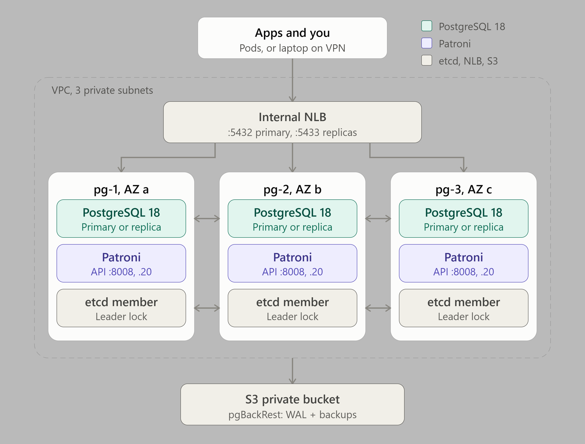

# PostgreSQL cluster on EC2 (Patroni)

A highly available PostgreSQL cluster on plain EC2, because Amazon RDS / Aurora
cost too much for this project. Three identical nodes, one per AZ, bootstrap
themselves at first boot, so `terraform apply` is the only step.

## Architecture



| Piece | What it does |
|---|---|
| **PostgreSQL 18** | The database, from the official PostgreSQL apt repository |
| **Patroni 4.1** | Runs PostgreSQL on each node, elects one primary, turns the others into streaming replicas, and promotes a replica if the primary fails |
| **etcd 3.6** (on the same 3 nodes) | Holds Patroni's leader lock. A majority (2 of 3) must agree, so two nodes can never both be primary |
| **Internal NLB** | One stable hostname. Port 5432 always reaches the primary, port 5433 the replicas; it follows failovers automatically |
| **pgBackRest → S3** | Weekly full and daily differential backups, plus every WAL file, in the private bucket under `backups/postgres/`: restore to any point in time within ~4 weeks |
| **Secrets Manager** | Superuser, replication and Patroni API passwords. Nodes read them at boot; nothing secret is in user data |
| **watchdog (softdog)** | Reboots a primary that freezes, so it can't keep taking writes after another node was promoted |

### Why 3 identical nodes, not "1 primary + 2 replicas"?

With Patroni, **any node can become the primary at any time** (failover, switchover,
maintenance). If the replicas were smaller than the primary, the database would run
degraded after every failover. So all three use `instance_type` (default `r8i.xlarge`),
and no instance is "the primary" in Terraform.

### Failover, step by step

1. The primary stops renewing its leader lock in etcd (crash, AZ outage, frozen OS).
2. After the lock expires (`ttl: 30` seconds), the healthiest replica takes it and promotes itself.
3. The NLB health checks see the change, and `:5432` points to the new primary about 10 seconds later.
4. Clients reconnect to the same hostname. **Your application must retry failed connections.**
5. When the old primary comes back, Patroni rewinds it (`pg_rewind`) and makes it a replica.

Expect **about 30–45 seconds of write downtime** for an unplanned failover, and a few
seconds for a planned switchover.

## Connecting

From a Kubernetes pod, or your laptop on the VPN:

```bash
# Read-write (primary)
psql "host=$(terraform output -raw postgres_endpoint) port=5432 user=postgres dbname=postgres sslmode=prefer"
# Read-only (replicas)
psql "host=$(terraform output -raw postgres_endpoint) port=5433 user=postgres dbname=postgres"
```

The superuser password is in Secrets Manager:

```bash
aws secretsmanager get-secret-value --secret-id "$(terraform output -raw postgres_secret_arn)" \
  --query SecretString --output text
```

**Don't let applications use `postgres`.** Create a user and database per application:

```sql
CREATE ROLE myapp LOGIN PASSWORD '...';
CREATE DATABASE myapp OWNER myapp;
```

## Operating the cluster

SSH to any node over the VPN (`terraform output postgres_node_private_ips`), then:

```bash
sudo -u postgres patronictl -c /etc/patroni/config.yml list            # who is primary, replica lag
sudo -u postgres patronictl -c /etc/patroni/config.yml switchover      # planned primary change
sudo -u postgres patronictl -c /etc/patroni/config.yml edit-config     # change PostgreSQL settings cluster-wide
sudo -u postgres pgbackrest --stanza=main info                         # list backups
sudo tail -f /var/log/pg-bootstrap.log                                 # first-boot log
journalctl -u patroni -f                                               # Patroni log
```

Change PostgreSQL settings with `patronictl edit-config`, **not** by editing
`postgresql.conf`: Patroni owns that file and overwrites it.

## Files

| File | What's in it |
|---|---|
| `compute.tf` | AMI lookup, key pair, the 3 instances, their EBS data volumes |
| `security-groups.tf` | Security group and rules (5432, 8008, etcd, SSH from VPN, ICMP) |
| `nlb.tf` | Internal NLB with the primary (5432) and replica (5433) target groups |
| `secret-manager.tf` | Generated passwords and the Secrets Manager secret |
| `iam.tf` | Node role: read its secret, read/write `backups/postgres/` in the private bucket |
| `scripts/` | First-boot scripts: `node-prep.sh` (OS, volume, packages), `etcd.sh`, `patroni.sh`, `pgbackrest.sh`, and `pg-backup.sh` (run by the backup timers) |

## Inputs

| Name | Default | Description |
|---|---|---|
| `project_name`, `environment` | (required) | Used in resource names |
| `vpc_id`, `vpc_cidr` | (required) | The VPC; its CIDR may connect to PostgreSQL |
| `private_subnet_ids`, `private_subnet_cidrs` | (required) | Exactly 3, one node per AZ; nodes get `.20` in each |
| `ssh_public_key` | (required) | Installed for user `ubuntu` |
| `ssh_source_security_group_id` | (required) | The VPN's security group |
| `instance_type` | `"r8i.xlarge"` | All 3 nodes |
| `data_volume_size` | `200` | GiB per node (gp3, encrypted) |
| `data_volume_iops` / `data_volume_throughput` | `3000` / `250` | gp3 performance per volume |
| `postgres_version` | `"18"` | Major version for new nodes (does not upgrade a running cluster) |
| `etcd_version` | `"3.6.16"` | etcd release |
| `backup_bucket_name`, `backup_bucket_arn` | (required) | The private bucket from the `s3` module |
| `backup_prefix` | `"backups/postgres"` | Where in that bucket pgBackRest keeps its repository |
| `backup_retention_full` | `4` | Weekly full backups kept |

## Outputs

`endpoint`, `read_write_port` (5432), `read_only_port` (5433), `node_private_ips`,
`secret_arn`, `backup_location` (`s3://<private-bucket>/backups/postgres/`).

## Things to know

- **Restore tests are the only proof backups work.** Restore into a scratch instance
  regularly (`pgbackrest --stanza=main restore`), at least before going live.
- **If no node passes the `/primary` health check** (in the seconds during a failover),
  the NLB "fails open" and spreads connections over all nodes. Replicas reject writes
  with `read-only transaction` errors, so nothing gets corrupted; clients just retry.
- **Don't connect to the NLB from the database nodes themselves.** The NLB preserves
  client IPs, so a node routed back to itself drops the connection. Use `localhost` there.
- **Backups live in the shared private bucket** (`s3` module), under `backups/postgres/`.
  Only pgBackRest deletes files there; the bucket's age-based lifecycle rules deliberately
  skip this prefix, because deleting backup or WAL files by age breaks restores.
  The nodes' IAM role can only touch this prefix.
- **Data volumes are separate from instances.** If an instance is replaced, its volume is
  re-attached. Destroying the volumes deletes the data on that node.
- **Changing `postgres_version` doesn't upgrade anything.** Major upgrades need
  `pg_upgrade` or logical replication, done by hand.

## Cost (rough, us-east-1)

3× `r8i.xlarge` (~$0.26/hour each), 3× 200 GiB gp3, the NLB (~$20/month) and S3 for backups.
Check the [AWS Pricing Calculator](https://calculator.aws/) for your region. Compare with
RDS Multi-AZ at the same size before deciding; RDS includes backups, patching and failover.

## TO-DO

- [ ] TLS for client connections (`ssl = on` with a certificate; `sslmode=require` in apps)
- [ ] TLS between etcd members (now plain HTTP, limited to this security group)
- [ ] Monitoring: postgres_exporter + alerts on replication lag, failovers, backup age
