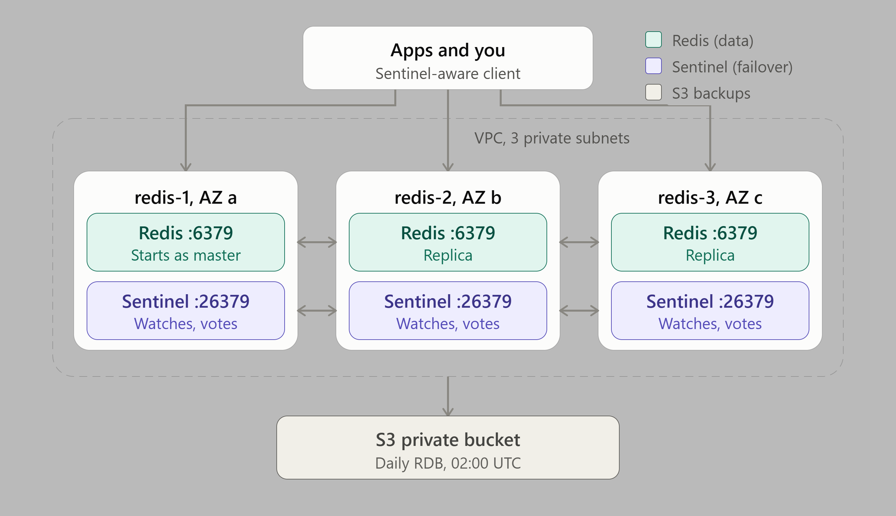

# Redis with Sentinel on EC2

A self-managed, highly available Redis: 3 identical `r8i.large` nodes, because AWS ElasiCache is expensive.
One per AZ in the private subnets. Every node runs **Redis** (data) and **Sentinel** (failover). The nodes bootstrap themselves at first boot, so `terraform apply` is the only step.



| Piece | What it does |
|---|---|
| **Redis 8.10** | From the official packages.redis.io repo. redis-1 starts as master, redis-2/3 replicate it |
| **Sentinel** | 3 sentinels watch the master. If 2 of them (the quorum) can't reach it for 5 s, they promote a replica and repoint the others |
| **Persistence** | RDB snapshots + append-only file (AOF, fsync every second) on a separate encrypted gp3 volume |
| **Backups** | Daily at 02:00 UTC, the current master uploads an RDB snapshot to the private bucket under `backups/redis/` (kept 30 days) |
| **Password** | Generated by Terraform, stored in Secrets Manager, read by the nodes at boot |

### Why 3 identical nodes?

Any node can become the master after a failover, so they're all the same size
(`instance_type`, default `r8i.large`: 16 GiB RAM, ~11 GiB usable by Redis). Three is
also the minimum for Sentinel: a majority (2 of 3) must agree before a failover, so a
node that is only cut off from the others can't trigger one on its own.

## Connecting: use a Sentinel-aware client

There's **no load balancer**. Your application asks the sentinels which node is the
master, and asks again after a failover. Every common client library supports this:

```python
# Python (redis-py)
from redis.sentinel import Sentinel
sentinel = Sentinel([("10.0.101.30", 26379), ("10.0.102.30", 26379), ("10.0.103.30", 26379)],
                    sentinel_kwargs={"password": PASSWORD}, password=PASSWORD)
master = sentinel.master_for("mymaster")   # writes
replica = sentinel.slave_for("mymaster")   # reads (optional)
```

```js
// Node.js (ioredis)
new Redis({ sentinels: [{ host: "10.0.101.30", port: 26379 }, /* ... */],
            name: "mymaster", password: PASSWORD, sentinelPassword: PASSWORD });
```

Java (Lettuce, Jedis), Go (go-redis `NewFailoverClient`) and Spring Boot
(`spring.data.redis.sentinel.*`) work the same way. The sentinel list, master name and
password are all in the Secrets Manager secret (`terraform output redis_secret_arn`).

**Don't hard-code one node's IP**: after a failover it may be a read-only replica.

## Operating the cluster

SSH to a node over the VPN (`terraform output redis_node_private_ips`), then:

```bash
export REDISCLI_AUTH='<password from Secrets Manager>'
redis-cli role                                              # master or slave, and its replicas
redis-cli -p 26379 sentinel get-master-addr-by-name mymaster  # who's master now
redis-cli -p 26379 sentinel replicas mymaster               # replica health
redis-cli -p 26379 sentinel failover mymaster               # planned failover (e.g. before maintenance)
redis-cli info replication
journalctl -u redis-server -u redis-sentinel -f
sudo tail -f /var/log/redis-bootstrap.log                   # first-boot log
```

**Don't edit `/etc/redis/*.conf` by hand while Redis runs.** Sentinel rewrites them
during failovers. Change settings with `redis-cli config set ...` followed by
`redis-cli config rewrite`, on every node.

## Things to know

- **Writes stop if the master has no replica.** `min-replicas-to-write 1`: the master
  refuses writes when it can't reach any replica, so a master cut off from the others
  doesn't accept writes that would be lost when the others elect a new master.
- **A failover can still lose the last second or so of writes.** Replication is
  asynchronous. Use Redis for data you can afford to lose a moment of, or rebuild.
- **`maxmemory_policy`** is `noeviction` (Redis as a data store: writes fail when full).
  Use `allkeys-lru` if this Redis is only a cache.
- **Restore a backup:** stop Redis on all nodes, copy the `.rdb` (gunzipped) to
  `/var/lib/redis/dump.rdb` on the master, move the `appendonlydir/` aside, start the master,
  then the replicas. Practise it once.

## Files

| File | What's in it |
|---|---|
| `compute.tf` | AMI lookup, key pair, the 3 instances, their EBS data volumes |
| `security-groups.tf` | 6379 and 26379 from the VPC, SSH from the VPN, ICMP |
| `secret-manager.tf` | Generated password and the Secrets Manager secret |
| `iam.tf` | Node role: read its secret, upload backups to `backups/redis/` |
| `scripts/` | First-boot scripts: `node-prep.sh` (kernel settings, data volume, Redis install), `redis.sh` (configs, services, backup timer), `redis-backup.sh` (daily backup) |

## Inputs

| Name | Default | Description |
|---|---|---|
| `project_name`, `environment` | (required) | Used in resource names |
| `vpc_id`, `vpc_cidr` | (required) | The VPC; its CIDR may connect to Redis and Sentinel |
| `private_subnet_ids`, `private_subnet_cidrs` | (required) | Exactly 3; nodes get `.30` in each |
| `ssh_public_key`, `ssh_source_security_group_id` | (required) | SSH key, and the VPN's security group |
| `backup_bucket_name`, `backup_bucket_arn` | (required) | The private bucket from the `s3` module |
| `backup_prefix` | `"backups/redis"` | Where in that bucket the backups go |
| `instance_type` | `"r8i.large"` | All 3 nodes |
| `data_volume_size` | `50` | GiB per node; keep it 2–3× the RAM (AOF rewrites and snapshots) |
| `redis_version` | `"8.10"` | Minor version from packages.redis.io |
| `sentinel_master_name` | `"mymaster"` | Name clients ask Sentinel for |
| `maxmemory_policy` | `"noeviction"` | `allkeys-lru` for a pure cache |

## Outputs

`sentinel_endpoints`, `sentinel_master_name`, `node_private_ips`, `secret_arn`, `backup_location`.

## TO-DO

- [ ] TLS for client and replication traffic (`tls-port`, certificates)
- [ ] ACL users per application instead of one shared password
- [ ] Monitoring: redis_exporter + alerts on failovers, memory use, replication lag
